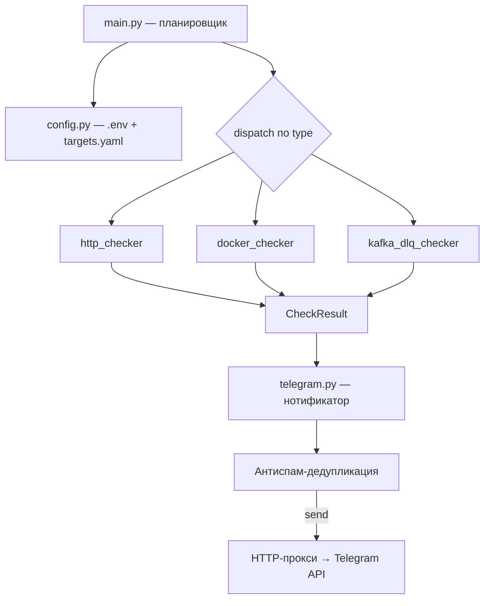

# AIOps Sentinel

Лёгкий, автономный Python-сервис мониторинга и предиктивной диагностики локальной AI-инфраструктуры (`mom-pipeline`, Docker-контейнеры Kafka/Redis, HTTP-эндпоинты, системные ресурсы и DLQ-очереди) с отправкой умных алертов в Telegram через внешний HTTP-прокси.

## Архитектура

Сервис работает по декларативной схеме: список целей мониторинга описывается в [`app/targets.yaml`](app/targets.yaml), а код не содержит жёстко заданных целей.



### Компоненты

- **`app/config.py`** — загрузка настроек из `.env` через `pydantic-settings` с валидацией и парсинг `targets.yaml` через `pydantic`.
- **`app/checkers/`** — модульные проверки:
  - `http_checker.py` — HTTP healthcheck;
  - `docker_checker.py` — проверка Docker-контейнеров;
  - `kafka_dlq_checker.py` — проверка DLQ-топика в Kafka;
  - `base.py` — единый интерфейс `BaseChecker` и dataclass `CheckResult`.
- **`app/notifiers/telegram.py`** — отправка форматированных алертов в Telegram Bot API с поддержкой `TELEGRAM_PROXY_URL` (HTTP-прокси с авторизацией) и антиспам-дедупликацией (cooldown по целям).
- **`app/main.py`** — основной цикл планировщика опроса целей + тестовый режим `--test-alert`.

## Быстрый старт

1. Установите зависимости:

   ```bash
   pip install -r requirements.txt
   ```

2. Скопируйте переменные окружения:

   ```bash
   cp .env.example .env
   ```

   Заполните реальными значениями в `.env`.

3. Запустите сервис:

   ```bash
   python -m app.main
   ```

4. Проверьте связь с Telegram:

   ```bash
   python -m app.main --test-alert
   ```

## Конфигурация

Все параметры задаются через `.env` (см. [`.env.example`](.env.example)) и декларативная конфигурация целей — через [`app/targets.yaml`](app/targets.yaml).

| Переменная | Описание |
|---|---|
| `TELEGRAM_BOT_TOKEN` | Токен Telegram-бота |
| `TELEGRAM_CHAT_ID` | ID чата Telegram |
| `TELEGRAM_PROXY_URL` | HTTP-прокси для Telegram API (с авторизацией) |
| `CHECK_INTERVAL_SEC` | Интервал опроса целей (сек) |
| `OLLAMA_URL` | URL Ollama |
| `OLLAMA_MODEL` | Модель Ollama |
| `KAFKA_BOOTSTRAP_SERVERS` | Kafka bootstrap servers |
| `KAFKA_DLQ_TOPIC` | DLQ-топик в Kafka |
| `REDIS_URL` | Redis URL |

## Безопасность

- Жёсткий запрет хардкода токенов, IP-адресов и паролей — все параметры в `.env`.
- Pre-commit хуки: Bandit (SAST) и блокировка коммита `.env` / приватных ключей.
- CI: GitHub Actions workflow `.github/workflows/security-ci.yml` — Bandit, secret-scan, проверка `.env`.

## Запуск через Docker

(Секция будет добавлена в следующих спринтах.)
